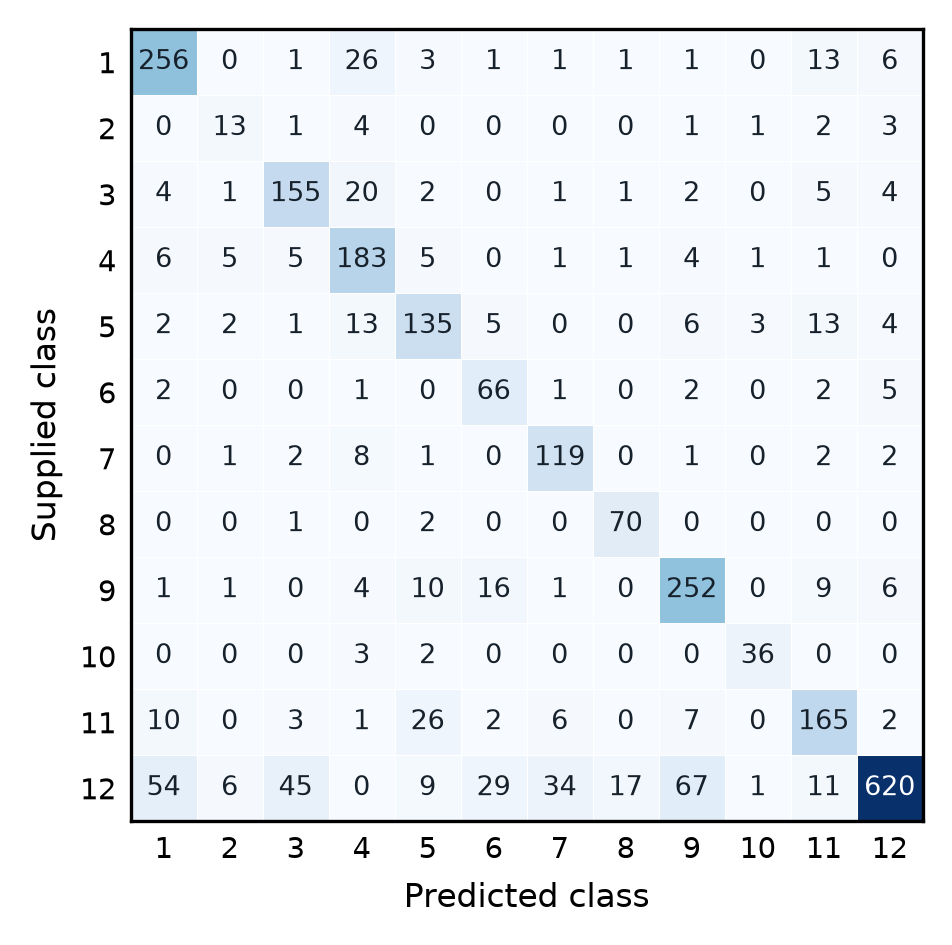

# Clinical Specialty Classification: Cross-Label Duplicates and Evaluation

Group [number] — [names and contribution percentages]

## 1. Introduction

Identical clinical notes can carry different specialty labels. We ask: **How does cross-label duplication affect the evaluation and prediction of medical specialties from clinical text?** We distinguish new records of known notes from unseen notes, compare three model families, and test a training-only label-exclusion decoder. Collection-specific decision rules can limit transfer [1]; weighting and augmentation provide additional comparisons.

## 2. Data

### 2.1. Data Analysis

Structural CSV repairs retain 2,669 cases and supplied labels across 12 specialties. Surgery contributes 893 cases (33.5%), versus 25 for Dermatology (0.9%). Cross-label transcription duplicates affect 1,528 cases (57.2%); their descriptions and titles are also identical, including 72/79 Neurosurgery cases. Thus, imbalance and label ambiguity are distinct limitations. We retain incomplete cases and exclude `keywords`: all 2,219 nonempty values start with the target specialty.

### 2.2. Data Augmentation

For four predefined minority classes (n<100: Dermatology, Neurosurgery, Ophthalmology, Psychiatry-Psychology), one variant deletes `max(1, floor(0.2m))` of m isolated, case-insensitive **the** tokens from each eligible training transcription, adapting random deletion [2]. Titles and other words remain intact; a SHA-256 seed uses seed 0, fold and record ID. Invalid/empty variants are skipped. Conditions are uniform originals (A), balanced originals (B), uniform deletion (C), balanced deletion (D), and balanced matched copies (E). D/E share sources and addition counts. Per protocol, 864/872 source visits yield variants, deleting 1.24% of their word tokens; clinical meaning preservation is unvalidated.

## 3. Models

Three scikit-learn families are compared [3]. Multinomial Naive Bayes (NB) implements the provided baseline: lowercased, Porter-stemmed `description`, TF-IDF, alpha=1 and empirical priors. Logistic regression (LR) and linear support vector classification (SVC) provide n-gram baselines [4]. They use separately L2-normalised `sample_name`/`transcription` TF-IDF blocks, giving nonzero field blocks equal norm. Exploratory LR ablation favoured this pair; NB differs in representation and classifier.

For each query, exclusion (EX) masks classes attached to exact training matches and selects the highest-scoring remaining class. Matching always uses `sample_name`/`transcription`, including for NB, lowercased with normalised whitespace; entirely empty inputs are ignored. The index uses original training cases only. No match or all classes blocked falls back to raw prediction. A corpus hypothesis motivates EX: additional records use labels not previously assigned to that input. This is not a clinical constraint.

## 4. Experimental Setup

We compare five-fold `StratifiedKFold` over rows (R) with `StratifiedGroupKFold` over notes (G), both shuffled with seed 0. G groups normalised nonempty transcriptions, using titles when missing and unique IDs for entirely empty inputs. Each protocol shares folds across conditions, evaluating seven configurations with/without EX. Features, weights, augmentation and exclusion indices use training folds only; unchanged validation originals yield pooled out-of-fold accuracy, macro F1 and per-class metrics.

R admits known notes; G tests unseen notes. EX must therefore be inactive in G. Field, parameter and decoder choices are exploratory [5]. Selection prioritises R accuracy subject to the project's minimum F1 ≥25%, then macro/minimum F1; otherwise macro F1 leads. The official accuracy target is >49%. G remains a separate transfer check. The official 398-case test only generates predictions; neither protocol measures its performance.

### 4.1. Parameters/Hyperparameters

LR/SVC use lowercased word unigram/bigram TF-IDF, sublinear term frequency, `min_df=2` (minimum document frequency), no stemming/stopword removal, L2, C=0.25 (inverse regularisation) and at most 2,000 iterations. LR uses multinomial log loss; SVC uses one-versus-rest squared hinge. Augmentation is tested only with LR. Each arm refits TF-IDF including its added texts. Balanced weights N/(12*n_class) use original training size N and class counts. Every original/child receives its class weight, then weights sum to N in every arm. Added rows still increase their sources' relative influence. D/E match counts and weights, while lexical changes can alter TF-IDF.

## 5. Results

Table 1 compares model families, decoders and protocols. Selected SVC+EX raises R accuracy from 46.16% to 77.56%, with 75.26% macro F1 and 48.15% minimum F1 (Dermatology). All 1,269 matched validation inputs have supplied labels absent from training matches. EX changes nothing in G, where SVC reaches 57.10% accuracy.

**Table 1. Pooled out-of-fold results (%). R: row-wise; G: grouped; EX: exclusion. LR uses balanced originals (B). Grouped EX equals raw. Bold marks selection.**

| System | CV | Accuracy | Macro F1 | Minimum F1 |
|---|---|---:|---:|---:|
| NB | R | 38.67 | 13.23 | 0.00 |
| NB | R+EX | 55.41 | 35.35 | 0.00 |
| NB | G | 41.14 | 15.26 | 0.00 |
| LR (B) | R | 48.78 | 51.81 | 31.86 |
| LR (B) | R+EX | 76.62 | 73.27 | 47.76 |
| LR (B) | G | 55.75 | 58.19 | 45.08 |
| SVC | R | 46.16 | 49.77 | 23.82 |
| **SVC** | **R+EX** | **77.56** | **75.26** | **48.15** |
| SVC | G | 57.10 | 60.28 | 43.51 |

Balanced-LR macro F1 for B/D/E is 73.27/66.02/65.97% in R+EX and 58.19/53.86/53.89% in G. Both additions underperform B; differences between D/E are small. Table 2 contrasts selected-system per-class results in both protocols; Figure 1 shows its R confusion matrix.

**Table 2. Selected SVC+EX support, row-wise precision/recall/F1, and grouped F1 (%). Rows define the class order in Figure 1.**

| Specialty | n | P_R | R_R | F1_R | F1_G |
|---|---:|---:|---:|---:|---:|
| 1 Cardiovascular-Pulmonary | 309 | 76.4 | 82.8 | 79.5 | 61.8 |
| 2 Dermatology | 25 | 44.8 | 52.0 | 48.1 | 50.0 |
| 3 Gastroenterology | 195 | 72.4 | 79.5 | 75.8 | 60.0 |
| 4 General Medicine | 212 | 69.6 | 86.3 | 77.1 | 77.4 |
| 5 Neurology | 184 | 69.2 | 73.4 | 71.2 | 58.0 |
| 6 Neurosurgery | 79 | 55.5 | 83.5 | 66.7 | 45.0 |
| 7 Obstetrics-Gynecology | 136 | 72.6 | 87.5 | 79.3 | 63.3 |
| 8 Ophthalmology | 73 | 77.8 | 95.9 | 85.9 | 72.3 |
| 9 Orthopedic | 300 | 73.5 | 84.0 | 78.4 | 58.2 |
| 10 Psychiatry-Psychology | 41 | 85.7 | 87.8 | 86.7 | 82.8 |
| 11 Radiology | 222 | 74.0 | 74.3 | 74.2 | 51.1 |
| 12 Surgery | 893 | 95.1 | 69.4 | 80.3 | 43.5 |

## 6. Discussion

Surgery to Orthopedic is the most frequent remaining confusion (67 cases).

Three remaining R errors illustrate limits. Case 309, "Temporal cheek-neck facelift", is labelled Dermatology: excluding Surgery changes the raw prediction to Radiology, still wrong. Removing an observed label does not identify the correct remaining one. Case 1383, "Anterior lumbar fusion, L4-L5, L5-S1", is labelled Orthopedic but remains Neurosurgery: only Surgery is excluded, leaving the wrong highest score intact. Case 314, "multiple prior excisions and staged graftings", is labelled Dermatology but predicted Surgery; without a training match, EX cannot intervene. These describe decoder behaviour, not clinical causes of the raw errors.

EX predicts an unobserved annotation conditioned on already observed labels, not a medically determined distinction between identical notes. Its gains depend on collection structure; future repetitions of an existing label could violate the assumption. Grouped and row-wise estimates answer different questions, so their difference is not an algorithmic improvement. Exact grouping does not eliminate approximate duplicates, patient dependence or selection bias. The deletion result concerns one conservative transformation, not augmentation in general.

## 7. Future Work

We would test exclusion on independent collections and adjudicated multi-label notes, separating annotation completion from specialty recognition. Nested selection and medically grounded lexical augmentation would address selection uncertainty and limited textual diversity.

**LLM use.** Codex assisted implementation, literature search, analysis and writing; an external Claude review prompted the protocol/decoder audit. Augmentation uses deterministic local rules, without LLM-generated clinical cases.

## Bibliography

[1] Geirhos et al. (2020). [Shortcut Learning in Deep Neural Networks](https://arxiv.org/abs/2004.07780). Nature Machine Intelligence.

[2] Wei and Zou (2019). [EDA: Easy Data Augmentation Techniques for Boosting Performance on Text Classification Tasks](https://aclanthology.org/D19-1670/).

[3] Pedregosa et al. (2011). [Scikit-learn: Machine Learning in Python](https://jmlr.org/papers/v12/pedregosa11a.html).

[4] Wang and Manning (2012). [Baselines and Bigrams: Simple, Good Sentiment and Topic Classification](https://aclanthology.org/P12-2018/).

[5] Cawley and Talbot (2010). [On Over-fitting in Model Selection and Subsequent Selection Bias in Performance Evaluation](https://www.jmlr.org/papers/v11/cawley10a.html).
